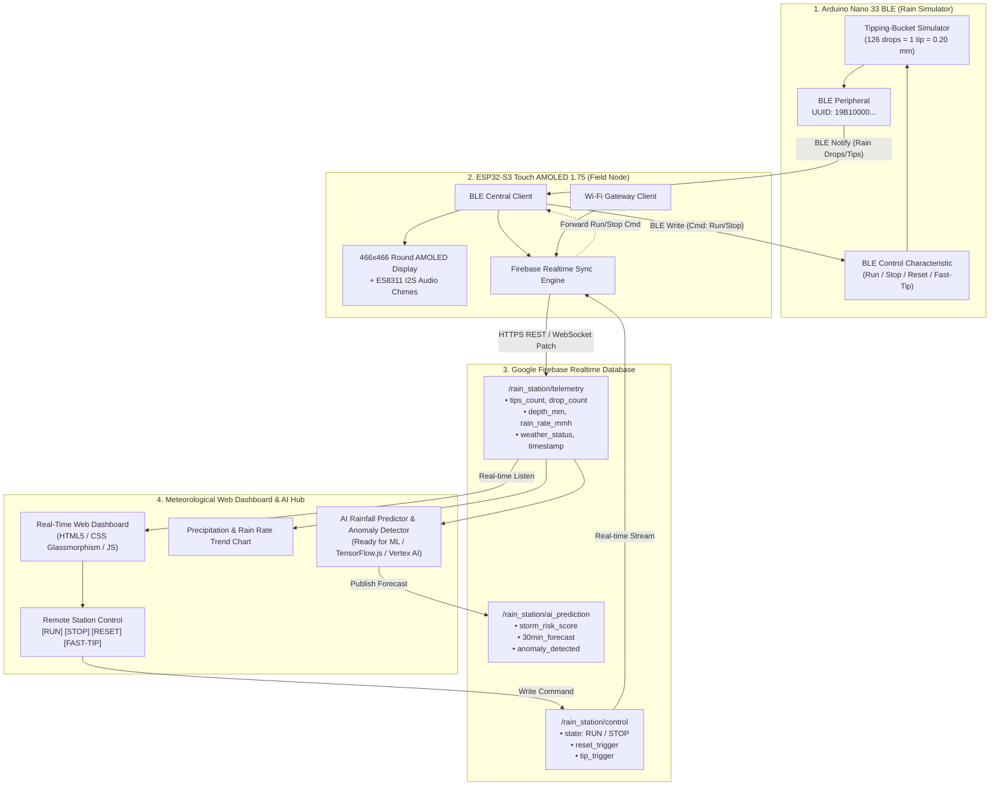

# 🌧️ Smart Rain Station IoT
### Intelligent Meteorological Telemetry, AMOLED Field Gateway & Cloud Forecasting

An end-to-end IoT meteorological telemetry, remote control, and AI-predictive rainfall system integrating the **Arduino Nano 33 BLE** (Physical Tipping-Bucket Simulator), the **Waveshare ESP32-S3 Touch AMOLED 1.75** (Field Station Gateway & Local Visual/Acoustic Display), and a **Real-Time Cloud Web Dashboard** powered by **Google Firebase Realtime Database**.

---

## 🏛️ System Architecture



---

## 📁 Project Structure

```
firebase-rain-ai-monitoring-system/
├── AMOLED_Rain_Receiver_Firebase/
│   └── AMOLED_Rain_Receiver_Firebase.ino    # ESP32-S3 AMOLED Firmware (BLE + Wi-Fi + Firebase + UI + Audio)
├── Nano33BLE_Rain_Transmitter_BiDir/
│   └── Nano33BLE_Rain_Transmitter_BiDir.ino # Nano 33 BLE Simulator (Drop simulation + Bidirectional BLE)
├── web-dashboard/
│   ├── index.html                           # Modern meteorological dashboard & AI forecasting UI
│   ├── style.css                            # Glassmorphism dark aesthetic matching AMOLED UI
│   ├── app.js                               # Real-time telemetry, remote commands, status classifier & AI stub
│   └── firebase-config.js                   # Firebase configuration with seamless Mock/Demo mode fallback
└── README.md                                # Full documentation and setup instructions
```

---

## ⚡ Key Highlights

1. **Bi-Directional Remote Control (RUN / STOP / RESET / FAST-TIP)**:
   - Command triggers on the web dashboard update Firebase `/rain_station/control`.
   - The ESP32-S3 AMOLED station receives the event instantly and writes over BLE to the Nano 33 BLE peripheral.
   - The Nano 33 BLE immediately starts or halts rainfall generation.

2. **Meteorological Classification Engine**:
   - Analyzes real-time tipping frequency ($1\text{ tip} = 0.20\text{ mm}$):
     - **Clear / Sunny**: $0.0\text{ mm/h}$
     - **Light Drizzle**: $< 2.5\text{ mm/h}$
     - **Moderate Rain**: $2.5 - 10.0\text{ mm/h}$
     - **Heavy Rain**: $10.0 - 50.0\text{ mm/h}$
     - **Thunderstorm / Torrential Alert**: $> 50.0\text{ mm/h}$

3. **Future AI-Model Readiness**:
   - Ready data structure for edge AI / Cloud inference (rolling tipping velocity, rainfall rate acceleration, pattern anomalies).
   - Interactive AI prediction widget on the dashboard predicting 30-minute flash-flood/storm risk and anomaly status.
